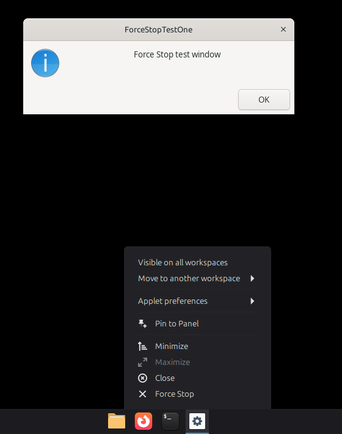
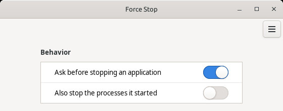

Adds a new extension, `force-stop@enisn`.

## Force Stop

Adds a **Force Stop** item to the right-click menu of the Grouped window list, for applications that no longer respond to Close. Stopping is done by Muffin: `Meta.Window.kill()` sends `SIGKILL` to the process that owns the window.

- The item sits below *Close*, or below *Close all* when the application has several windows.
- A confirmation dialog names the application and the process that is about to be stopped. `Escape` cancels it.
- The item is greyed out for windows without a process ID, and for processes of another user such as an application running as root.

## Settings

| Setting | Default | Effect |
| --- | --- | --- |
| Ask before stopping an application | On | Shows the confirmation dialog. Off stops the application as soon as the item is clicked. |
| Also stop the processes it started | Off | Also stops the helper processes of the application, including anything launched from its built-in terminal. |

Both use the xlet settings interface and take effect at once.

## Notes for review

- The right-click menu of the window list is a private class. The extension wraps `PopupMenuManager.addMenu` to reach each menu when it is created, and adds the item after the window list has filled its menu. Everything is restored in `disable()`. No file of Cinnamon is touched, and if a Cinnamon update changes the window list, only the item is missing until the extension is updated.
- Child processes are read from `/proc/<pid>/task/*/children` before the application is stopped, because the kernel reparents them once it is gone. They are stopped with the application in one `kill` call that takes an argument array. GJS has no way to signal a process it did not start itself.
- The one synchronous lookup is the owner of `/proc/<pid>` when the menu opens, which is needed to grey the item out. `/proc` answers from memory.
- User-visible strings are translatable. The template is in `po/`.

## Testing

Tested on Cinnamon 6.6.9 (Linux Mint 22.3, X11) with an end-to-end suite that starts a private Cinnamon on Xephyr and drives it with real clicks. Its 31 checks cover the menu in single and multi-window groups, the confirmation dialog and cancelling it, both settings through Cinnamon's own settings page, the process tree (a child and a grandchild are stopped while an unrelated process is left alone), and disabling, enabling and reloading. The Cinnamon log shows no error from the extension. The suite is in the extension's repository: https://github.com/enisn/cinnamon-force-stop
